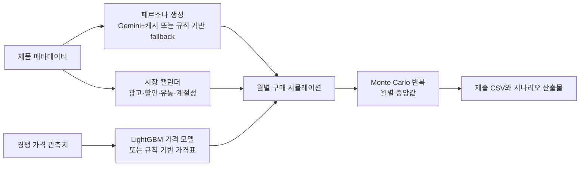

# 신제품 콜드스타트 수요 시뮬레이션

[English](README.md) · [사례 연구](PORTFOLIO.ko.md)

판매 이력이 없는 식품 신제품 15종의 12개월 수요 시나리오를 만듭니다. 가격·판촉·광고·유통·계절성 가정 아래에서 합성 소비자 페르소나의 월별 구매를 시뮬레이션합니다. 2025 동원×KAIST AI Competition(2025년 8~9월) 프로젝트입니다.

**왜 중요한가:** 출시 물량, 재고, 판촉 시점은 판매 데이터가 생기기 전에 정해야 하므로 예측 모델이 학습할 타깃이 없습니다. 이 파이프라인은 각 가정을 명시적이고 수정 가능한 입력으로 둡니다.

**예시 시나리오:** 프리미엄 참치액 조미소스 900g에 대해 저장된 Monte Carlo 실행 1회는 12개월 합계 7,207,421 EA를 만듭니다. 가정한 유통 커버리지가 35%에서 100%로 늘고 재구매가 쌓이면서 런칭월 123,287 EA에서 12개월 차 1,321,951 EA로 증가합니다. 예측 정확도가 아닌 시나리오 결과입니다.

## 데이터와 가정

- [`data/product_info.csv`](data/product_info.csv): 제품 15종의 이름, 특징 문구(원료, 광고 시기, 광고 모델), 3단계 카테고리.
- [`data/category_prices.csv`](data/category_prices.csv): 2025-08-26 네이버쇼핑에서 수집한 정가 15건.
- `forecast_pipeline.py`의 직접 정한 기본값(`results/calibrated_theta.json` 없음): 기본 인지율 0.18, 시용률 0.35, 재구매율 0.55, 가격 탄력성 -1.2, 광고 효과 100 GRP(총 시청률)당 0.10, 판촉 가격 전가율 0.8. 시장 규모는 카테고리별 경험칙입니다.

## 시나리오 설계



각 페르소나는 속성, 가격, 할인, 광고, 유통, 계절성으로 구매 효용을 계산합니다. 월별 시용 수량은 시장 규모 × 평균 구매 확률이고, 재구매 수량은 누적 시용에 비례해 늘어납니다. 제품마다 Monte Carlo를 여러 번 돌려 월별 중앙값을 제출 파일에 남깁니다. 자세한 구조: [docs/ARCHITECTURE.md](docs/ARCHITECTURE.md).

## 결과

| 보관된 실행(프리미엄 조미소스 900g) | 값 | 출처 |
|---|---:|---|
| 1개월 차 시뮬레이션 수량 | 123,287 | `results/monthly_forecast.csv` |
| 12개월 차 시뮬레이션 수량 | 1,321,951 | `results/monthly_forecast.csv` |
| 12개월 합계 | 7,207,421 | `results/solution_report.md` |
| 가격 입력 | 14,093원 | `results/solution_report.md` |

노트북 로그(`notebooks/02_final_demand_forecast.ipynb`)에 나온 이 실행의 두 입력:

- **가격.** 관측 가격 15건 중 12건으로 학습한 LightGBM 가격 모델은 분할을 찾지 못했고(학습 R² 0.0, 테스트 R² -0.18), 모든 제품에 학습 평균 14,093원을 반환합니다. 따라서 시나리오들은 가격으로 구분되지 않습니다.
- **페르소나.** `persona_count`는 400이었지만 Gemini 호출이 이 제품에 대해 페르소나 3개를 반환했고, 캐시된 3개가 7회 실행 모두에 재사용됐습니다. 보고서에는 요청값 400이 기록됩니다.

## 실행

Python 3.13.2에서 스크립트 컴파일과 `--help` 실행을 확인했습니다.

```powershell
pip install -r requirements.txt
python forecast_pipeline.py make_submission --help
python forecast_pipeline.py make_submission `
  --product_csv data\product_info.csv `
  --out_csv results\submission.csv `
  --use_llm 0 --persona_count 400 --mc_runs 7
```

`--use_llm 0`은 규칙 기반 페르소나를 쓰며 API 키가 필요 없습니다. Gemini 페르소나(`--use_llm 1`)에는 `GOOGLE_API_KEY`와 `google-generativeai` 패키지가, `gather_prices`에는 네이버 API 자격증명이 필요합니다. `results/price_model.pkl`이 없으면 규칙 기반 가격표를 쓰므로 새 실행은 보관된 시나리오와 다릅니다. 출력은 `results/`(예측, 프롬프트, 출처, 보고서)와 `persona_cache/`에 저장됩니다.

## 한계

- 예측이 아니라 시뮬레이션입니다. 실제 판매, 백테스트, 대회 점수가 없습니다.
- 민감도 분석은 아직 없어, 어떤 가정이 합계를 가장 크게 움직이는지 측정하지 않았습니다.
- 가격 관측치 15건으로는 가격 모델이 상수가 됩니다(결과 참고).
- 재실행 결과가 비트 단위로 같지 않습니다. 제품별 seed와 시장 규모가 프로세스마다 바뀌는 Python 문자열 해시에서 나오고(`PYTHONHASHSEED` 미고정 시), 규칙 기반 페르소나와 노이즈는 seed 없는 NumPy 전역 난수 생성기를 씁니다.
- 시용 수량을 미시용 인구에서 차감하지 않으므로, 누적 시용 수량은 고유 구매자 수가 아니라 구매량입니다.
- `results/solution_report.md`와 `results/monthly_forecast.csv`는 마지막 제품의 마지막 Monte Carlo 실행을 담고 있으며, 15개 제품 제출 파일 `results/submission_3.csv`의 실행 설정은 기록되지 않았습니다.

## 저장소 구조

```text
forecast_pipeline.py     유지 중인 CLI: gather_prices, train_price_model, make_submission
project_config.py        결과·캐시·모델·보정 파일 경로
simulation_pipeline.py   별도의 단순화 예제(유지 중인 엔진 아님)
data/                    제품 목록과 관측 가격 15건
notebooks/               출력이 저장된 실험·최종 실행 노트북
results/                 보관된 시나리오, 프롬프트, 출처, 제출 파일
```

## 문서

- [포트폴리오 사례 연구](PORTFOLIO.ko.md)
- [아키텍처](docs/ARCHITECTURE.md)
- [프로젝트 리뷰](docs/PROJECT_REVIEW.md)
