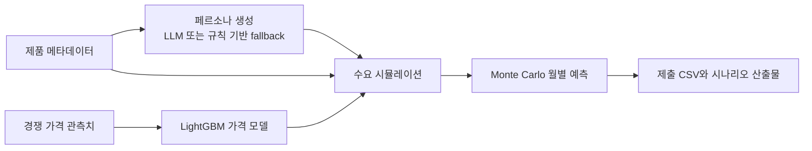

# 신제품 콜드스타트 수요 시뮬레이션

[English](README.md)

> [프로젝트 자세히 보기](PORTFOLIO.ko.md)

판매 이력이 없는 신제품을 대상으로 12개월 수요 시나리오를 만드는 프로토타입입니다. 제품 메타데이터, 합성 소비자 페르소나, 시장 가정, Monte Carlo 시뮬레이션을 함께 사용합니다.

## 파이프라인



## 확인 가능한 근거

- `forecast_pipeline.py`는 Gemini 페르소나와 파일 캐시를 지원하며, `--use_llm 0`이면 seed 기반 규칙 페르소나로 같은 흐름을 실행합니다.
- `data/category_prices.csv`에는 가격 관측치 **15건**이 남아 있습니다.
- `results/monthly_forecast.csv`에는 12개월 시나리오가 들어 있습니다. 첫 달은 123,287 EA이며, `results/solution_report.md`는 연간 합계 7,207,421 EA를 기록합니다.

이 값은 시뮬레이션 결과일 뿐 실제 판매, 예측 정확도, 가격, 비즈니스 영향 지표가 아닙니다. 보관된 가격 표본 15건은 운영 환경의 가격 정책을 일반화하기에 작습니다.

## 실행

```powershell
python forecast_pipeline.py make_submission `
  --product_csv data\product_info.csv `
  --out_csv results\submission.csv `
  --use_llm 0 --persona_count 400 --mc_runs 7
```

LLM 페르소나를 쓰려면 `GOOGLE_API_KEY`가 필요합니다. 가격 수집에는 Naver API 자격증명도 필요합니다. `project_config.py`는 모델·보정·생성 산출물의 위치를 `results/` 아래에서 관리합니다.

## 문서

- [포트폴리오 사례 연구](PORTFOLIO.ko.md)
- [아키텍처](docs/ARCHITECTURE.md)
- [프로젝트 리뷰](docs/PROJECT_REVIEW.md)
