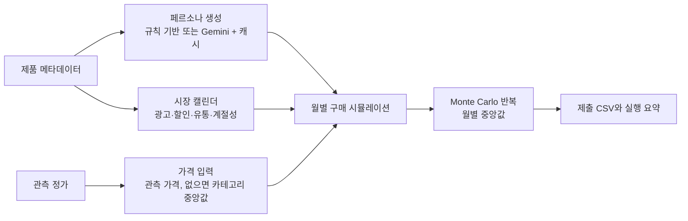

# 신제품 콜드스타트 수요 시뮬레이션

판매 이력이 없는 식품 신제품 15종을 위한 페르소나 기반 Monte Carlo 시뮬레이터입니다. 인지율, 시용률, 재구매율, 가격 탄력성을 입력값으로 바꿔 볼 수 있습니다. 2025 동원×KAIST AI Competition(2025년 8~9월)에 참가하며 만들었습니다.

**문제.** 출시 물량, 재고, 판촉 시점은 판매 데이터가 생기기 전에 정해야 하므로 예측 모델이 학습할 타깃이 없습니다. 이 시뮬레이터는 가격·판촉·광고·유통·계절성 가정을 각각 명시적인 입력으로 두고 12개월 수요 시나리오를 만듭니다.

**결과.** seed 42, 규칙 기반 페르소나 400명, 관측 정가로 실행하면 프리미엄 참치액 조미소스 900g의 12개월 합계는 3,070,766개입니다(Monte Carlo 7회의 월별 중앙값). 15종 제품의 12개월 합계는 1,941,646개에서 7,918,193개 사이입니다. 같은 seed로 다시 실행하면 파일이 그대로 재현됩니다. 예측 정확도가 아니라 시나리오 결과입니다.

**범위.** 실제 판매량이나 백테스트가 없는 시뮬레이션입니다. 데이터는 포함되어 있으며, `python forecast_pipeline.py make_submission --product_csv data\product_info.csv --use_llm 0`로 API 키 없이 규칙 기반 시나리오를 실행할 수 있습니다.

[English](README.md) · [사례 연구](PORTFOLIO.ko.md) · [아키텍처](docs/ARCHITECTURE.md)

## 데이터와 가정

- [`data/product_info.csv`](data/product_info.csv): 제품 15종의 이름, 특징 문구(원료, 광고 시기, 광고 모델), 3단계 카테고리.
- [`data/category_prices.csv`](data/category_prices.csv): 2025-08-26 네이버쇼핑에서 제품마다 한 건씩 수집한 정가 15건.
- `forecast_pipeline.py`에 직접 정한 기본값: 기본 인지율 0.18, 시용률 0.35, 재구매율 0.55, 가격 탄력성 -1.2, 광고 효과 100 GRP(총 시청률)당 0.10, 판촉 가격 전가율 0.8. 시장 규모는 카테고리별 경험칙입니다.

## 시나리오 설계



각 페르소나는 자신의 속성, 가격, 할인, 광고, 유통, 계절성으로 구매 효용을 얻습니다. 월별 시용 수량은 시장 규모×평균 구매 확률이고, 재구매 수량은 누적 시용에 비례해 늘어납니다. 제품마다 Monte Carlo를 여러 번 돌리고 제출 파일에는 월별 중앙값을 남깁니다. 자세한 내용: [docs/ARCHITECTURE.md](docs/ARCHITECTURE.md).

**재현성.** 모든 난수는 `--seed`(기본값 42)와 제품명의 CRC32 해시로 초기화한 NumPy 생성기에서 나오므로, 결과가 `PYTHONHASHSEED`에 따라 달라지지 않습니다. seed 42로 두 번(한 번은 `PYTHONHASHSEED=123`) 실행한 제출 파일은 완전히 같았고, seed 7은 다른 파일을 만들었습니다.

**페르소나.** 규칙 기반 경로는 Monte Carlo 실행마다 정확히 `--persona_count`명을 만듭니다. LLM이나 캐시가 그보다 적게 돌려주면 실제 인원을 경고로 남기고 `results/run_summary.csv`에 기록합니다.

**가격 입력.** 제품마다 다음 순서로 가격을 정합니다. `product_info.csv`에 `price`나 `list_price` 컬럼이 있으면 그 값, 관측 정가, 저장된 LightGBM 모델, 같은 카테고리 관측 가격의 중앙값, 직접 정한 단가표 순입니다. `train_price_model`은 관측 가격 15건의 leave-one-out에서 카테고리 중앙값보다 나을 때만 모델을 저장합니다. 결과는 그렇지 않았습니다.

| leave-one-out, 가격 15건 | MAE(원) | MAPE |
|---|---:|---:|
| 카테고리 중앙값(기준선) | 4,920 | 101.3% |
| LightGBM, 대회 당시 설정 | 7,722 | 147.3% |
| LightGBM, 소규모 데이터 설정 | 9,474 | 196.1% |

따라서 모델은 저장되지 않고, 15종 모두 관측 정가로 실행합니다. 대회 당시 12행으로 학습한 모델은 분할을 하나도 찾지 못해(학습 R² 0.0000, 테스트 R² -0.1779) 모든 제품에 14,093원을 돌려주었습니다.

## 결과

`results/submission.csv`, seed 42, 규칙 기반 페르소나 400명, Monte Carlo 7회:

| 프리미엄 조미소스 900g | 값 |
|---|---:|
| 1개월 차 시뮬레이션 수량 | 54,580개 |
| 12개월 차 시뮬레이션 수량 | 471,831개 |
| 12개월 합계 | 3,070,766개 |
| 가격 입력(관측) | 22,400원 |

증가는 가정한 유통 커버리지 확대(35%→100%)와 누적 시용에 비례하는 재구매에서 나옵니다. 시용한 수량을 미시용 풀에서 빼지 않으므로, 누적 시용 수량은 고유 구매자 수가 아니라 구매량입니다. 제품별 가격, 시장 규모, 페르소나 수, seed는 `results/run_summary.csv`에 있습니다.

대회 실행(Gemini, 페르소나 3명, 모든 제품 14,093원)에서는 같은 제품이 Monte Carlo 1회 기준 7,207,421개였습니다. 그 파일은 `results/competition_2025/`에 보관합니다.

## 실행

```powershell
pip install -r requirements.txt
python forecast_pipeline.py make_submission --product_csv data\product_info.csv --use_llm 0
python forecast_pipeline.py make_submission --product_csv data\product_info.csv --use_llm 0 --seed 7 --persona_count 400 --mc_runs 7
python forecast_pipeline.py train_price_model    # leave-one-out 가격 비교
```

첫 명령은 약 40초 걸립니다. `--use_llm 0`은 규칙 기반 페르소나를 쓰므로 API 키가 필요 없습니다. Gemini 페르소나(`--use_llm 1`)에는 `GOOGLE_API_KEY`와 `google-generativeai` 패키지가, `gather_prices`에는 네이버 API 인증 정보가 필요합니다. 출력은 `results/`와 `persona_cache/`에 저장됩니다.

## 한계

- 예측이 아니라 시뮬레이션입니다. 실제 판매량, 백테스트, 대회 점수가 없습니다.
- 관측 정가는 제품마다 한 건이고 용량과 함께 움직이지 않으므로(90g 19,050원, 135g 16,275원), 가격 효과에 그 잡음이 그대로 들어갑니다.
- 규칙 기반 페르소나는 무작위로 뽑은 값이며 설문이나 패널 데이터에 맞춘 것이 아닙니다.
- 민감도 분석이 없어 어떤 가정이 합계를 가장 크게 움직이는지 모릅니다.

## 저장소 구성

```text
forecast_pipeline.py     유지 중인 CLI: gather_prices, train_price_model, make_submission
project_config.py        결과·캐시·모델·보정 파일 경로
simulation_pipeline.py   별도의 단순화 예제(유지 중인 엔진 아님)
data/                    제품 목록과 관측 가격 15건
notebooks/               출력이 저장된 실험·최종 실행 노트북
results/                 seed 42 실행: 제출 파일, 실행 요약, 보고서, 월별 구성 요소, 프롬프트
results/competition_2025/ 대회 실행 보고서, 월별 예측, 프롬프트, 출처, 제출 파일
```

## 문서

- [포트폴리오 사례 연구](PORTFOLIO.ko.md)
- [아키텍처](docs/ARCHITECTURE.md)
