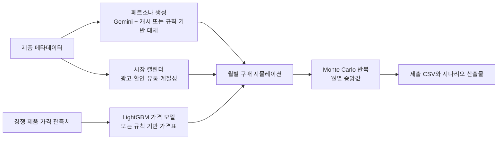

# 신제품 콜드스타트 수요 시뮬레이션

판매 이력이 없는 식품 신제품 15종을 위한 페르소나 기반 Monte Carlo 시뮬레이터입니다. 인지율, 시용률, 재구매율, 가격 탄력성을 입력값으로 바꿔 볼 수 있습니다. 2025 동원×KAIST AI Competition(2025년 8~9월)에 참가하며 만들었습니다.

**문제.** 출시 물량, 재고, 판촉 시점은 판매 데이터가 생기기 전에 정해야 하므로 예측 모델이 학습할 타깃이 없습니다. 이 시뮬레이터는 가격·판촉·광고·유통·계절성 가정을 각각 명시적인 입력으로 두고 12개월 수요 시나리오를 만듭니다.

**결과.** 페르소나 3명으로 한 번 실행한 결과, 프리미엄 참치액 조미소스 900g의 12개월 합계는 7,207,421개입니다. 예측 정확도가 아니라 시나리오 결과입니다.

**범위.** 실제 판매량이나 백테스트가 없는 시뮬레이션이며, 페르소나 3명을 모든 몬테카를로 실행에 재사용했고 가격은 모든 제품이 같습니다. 데이터는 포함되어 있으며, `python forecast_pipeline.py make_submission --product_csv data\product_info.csv --use_llm 0`로 API 키 없이 규칙 기반 시나리오를 실행할 수 있습니다.

[English](README.md) · [사례 연구](PORTFOLIO.ko.md) · [아키텍처](docs/ARCHITECTURE.md)

## 데이터와 가정

- [`data/product_info.csv`](data/product_info.csv): 제품 15종의 이름, 특징 문구(원료, 광고 시기, 광고 모델), 3단계 카테고리.
- [`data/category_prices.csv`](data/category_prices.csv): 2025-08-26 네이버쇼핑에서 수집한 정가 15건.
- `forecast_pipeline.py`에 직접 정한 기본값: 기본 인지율 0.18, 시용률 0.35, 재구매율 0.55, 가격 탄력성 -1.2, 광고 효과 100 GRP(총 시청률)당 0.10, 판촉 가격 전가율 0.8. 시장 규모는 카테고리별 경험칙입니다.

## 시나리오 설계



각 페르소나는 자신의 속성, 가격, 할인, 광고, 유통, 계절성으로 구매 효용을 얻습니다. 월별 시용 수량은 시장 규모×평균 구매 확률이고, 재구매 수량은 누적 시용에 비례해 늘어납니다. 제품마다 Monte Carlo를 여러 번 돌리고 제출 파일에는 월별 중앙값을 남깁니다. 자세한 내용: [docs/ARCHITECTURE.md](docs/ARCHITECTURE.md).

## 결과

| 단일 실행, 페르소나 3명(프리미엄 조미소스 900g) | 값 |
|---|---:|
| 1개월 차 시뮬레이션 수량 | 123,287개 |
| 12개월 차 시뮬레이션 수량 | 1,321,951개 |
| 12개월 합계 | 7,207,421개 |
| 가격 입력 | 14,093원 |

증가는 가정한 유통 커버리지 확대(35%→100%)와 누적 시용에 비례하는 재구매에서 나옵니다. 시용한 수량을 미시용 풀에서 빼지 않으므로, 누적 시용 수량은 고유 구매자 수가 아니라 구매량입니다.

## 실행

```powershell
pip install -r requirements.txt
python forecast_pipeline.py make_submission `
  --product_csv data\product_info.csv `
  --out_csv results\submission.csv `
  --use_llm 0 --persona_count 400 --mc_runs 7
```

`--use_llm 0`은 규칙 기반 페르소나를 쓰므로 API 키가 필요 없습니다. Gemini 페르소나(`--use_llm 1`)에는 `GOOGLE_API_KEY`와 `google-generativeai` 패키지가, `gather_prices`에는 네이버 API 인증 정보가 필요합니다. `results/price_model.pkl`이 없으면 규칙 기반 가격표를 쓰므로 새로 실행한 결과는 위 시나리오와 다릅니다. `PYTHONHASHSEED`를 고정하지 않으면 재실행 결과가 매번 조금씩 달라집니다. 출력은 `results/`와 `persona_cache/`에 저장됩니다.

## 한계

- 예측이 아니라 시뮬레이션입니다. 실제 판매량, 백테스트, 대회 점수가 없습니다.
- 페르소나가 3명뿐입니다. `persona_count`는 400이었지만 Gemini가 이 제품에 페르소나 3명만 돌려주었고, 그 3명을 Monte Carlo 7회 전부에 다시 썼습니다.
- 가격이 제품을 구분하지 못합니다. 관측 가격 15건 중 12건으로 학습한 LightGBM 가격 모델이 분할을 하나도 찾지 못해(학습 R² 0.0000, 테스트 R² -0.1779) 모든 제품에 14,093원을 돌려줍니다.
- 민감도 분석이 없어 어떤 가정이 합계를 가장 크게 움직이는지 모릅니다.

## 저장소 구성

```text
forecast_pipeline.py     유지 중인 CLI: gather_prices, train_price_model, make_submission
project_config.py        결과·캐시·모델·보정 파일 경로
simulation_pipeline.py   별도의 단순화 예제(유지 중인 엔진 아님)
data/                    제품 목록과 관측 가격 15건
notebooks/               출력이 저장된 실험·최종 실행 노트북
results/                 시나리오 보고서, 월별 예측, 프롬프트, 출처, 제출 파일
```

## 문서

- [포트폴리오 사례 연구](PORTFOLIO.ko.md)
- [아키텍처](docs/ARCHITECTURE.md)
