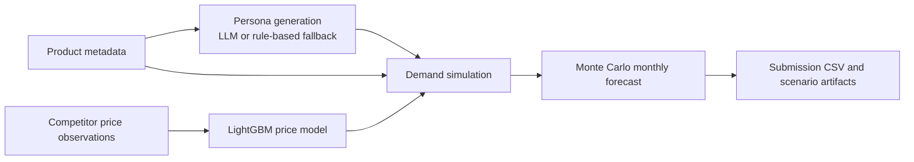

# Cold-Start Demand Simulation for New Products

[한국어](README.ko.md)

> [Project details](PORTFOLIO.md)

This project prototypes 12-month demand scenarios for products without sales
history. It combines product metadata, synthetic consumer personas, market
assumptions, and Monte Carlo simulation.

## Pipeline



## Verified evidence

- `forecast_pipeline.py` supports Gemini personas with file caching and a
  deterministic rule-based fallback when `--use_llm 0` is used.
- `data/category_prices.csv` contains **15** retained price observations.
- `results/monthly_forecast.csv` contains a 12-month scenario. Its first month
  is 123,287 simulated units; `results/solution_report.md` records an annual
  scenario total of 7,207,421 units.

These are simulated outputs, not observed sales, forecast-accuracy, pricing,
or business-impact metrics. The retained price sample is too small for
production pricing claims.

## Run

```powershell
python forecast_pipeline.py make_submission `
  --product_csv data\product_info.csv `
  --out_csv results\submission.csv `
  --use_llm 0 --persona_count 400 --mc_runs 7
```

Enable LLM personas only with `GOOGLE_API_KEY`. Price collection additionally
needs Naver API credentials.

`project_config.py` centralizes model, calibration, and generated-artifact
locations under `results/`. Simulation behaviour and CLI defaults are unchanged.

## Documentation

- [Portfolio case study](PORTFOLIO.md)
- [Architecture](docs/ARCHITECTURE.md)
- [Project review](docs/PROJECT_REVIEW.md)
