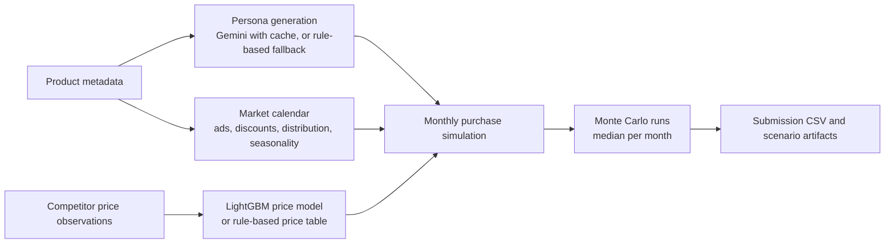

# Cold-Start Demand Simulation for New Products

[한국어](README.ko.md) · [Case study](PORTFOLIO.md)

Generates 12-month demand scenarios for 15 new food products that have no
sales history, by simulating synthetic consumer personas month by month under
price, promotion, advertising, distribution, and seasonality assumptions.
Built for the 2025 Dongwon x KAIST AI Competition (August to September 2025).

**Why it matters:** launch volumes, inventory, and promotion timing have to be
planned before any sales exist, so a forecasting model has no target to learn
from. The useful question becomes which assumptions move the plan, and the
pipeline makes each assumption an explicit, editable input.

**Retained scenario:** for one product (a 900 g premium tuna-extract seasoning
sauce), one stored Monte Carlo run produced 7,207,421 simulated units over 12
months, rising from 123,287 in the launch month to 1,321,951 in month 12 as
assumed distribution coverage ramps from 35% to 100% and repeat purchases
accumulate. This is a scenario output, not observed sales or forecast
accuracy: no launch data exists to score it, and no competition score is
retained.

## Data and assumptions

- [`data/product_info.csv`](data/product_info.csv): 15 products with name,
  feature text (ingredients, advertising months, ad model), and a three-level
  category.
- [`data/category_prices.csv`](data/category_prices.csv): 15 list prices
  collected from Naver Shopping on 2025-08-26.
- Hand-set defaults in `forecast_pipeline.py`, used because no
  `results/calibrated_theta.json` exists: base awareness 0.18, trial rate 0.35,
  repeat rate 0.55, price elasticity -1.2, ad effect 0.10 per 100 GRP, promotion
  pass-through 0.8. Market size is a per-category heuristic.

## Scenario design



Each persona gets a purchase utility from its attributes, price, discounts,
advertising, distribution, and seasonality. Monthly trial units are market size
x mean purchase probability; repeat units grow with cumulative trials. Each
product runs several Monte Carlo times and the submission keeps the per-month
median. Details: [docs/ARCHITECTURE.md](docs/ARCHITECTURE.md).

## Findings and what drove them

| Retained run (premium seasoning sauce 900 g) | Value | Source |
|---|---:|---|
| Month 1 simulated units | 123,287 | `results/monthly_forecast.csv` |
| Month 12 simulated units | 1,321,951 | `results/monthly_forecast.csv` |
| 12-month total | 7,207,421 | `results/solution_report.md` |
| Price input | KRW 14,093 | `results/solution_report.md` |

The saved notebook log (`notebooks/02_final_demand_forecast.ipynb`) explains
two inputs behind this run:

- **Price.** The LightGBM price model was trained on 12 of the 15 observed
  prices and found no split (train R² 0.0, test R² -0.18). It therefore
  returns the training mean, KRW 14,093, for every product, so the retained
  scenarios do not differ by price.
- **Personas.** `persona_count` was set to 400, but the Gemini call returned
  3 personas for this product, and those cached 3 were reused across all seven
  runs. The report prints the requested 400.

No sensitivity sweep is retained, so which assumption moves the total most is
not yet measured.

## Limits

- Simulation, not forecast: no observed sales, backtest, or competition score.
- With 15 price observations the price model is not informative (see above).
- Reruns are not bit-identical. Per-product seeds and market sizes come from
  Python's built-in string hash, which changes between processes unless
  `PYTHONHASHSEED` is fixed, and the rule-based personas and noise draw from
  NumPy's global generator, which the code does not seed.
- Trial units are not removed from the untried pool, so cumulative trial units
  are purchase volume, not unique buyers.
- `results/solution_report.md` and `results/monthly_forecast.csv` hold the last
  single Monte Carlo run of the last product; `results/submission_3.csv` is a
  stored 15-product submission whose run settings are not recorded.

## Run

Checked with Python 3.13.2: the scripts compile and `--help` runs for the
CLI. The simulation itself was not rerun for this README.

```powershell
pip install -r requirements.txt
python forecast_pipeline.py make_submission --help
python forecast_pipeline.py make_submission `
  --product_csv data\product_info.csv `
  --out_csv results\submission.csv `
  --use_llm 0 --persona_count 400 --mc_runs 7
```

`--use_llm 0` uses rule-based personas and needs no API key. Gemini personas
(`--use_llm 1`) need `GOOGLE_API_KEY` and the `google-generativeai` package;
`gather_prices` needs Naver API credentials. Without `results/price_model.pkl`
the rule-based price table is used, so a fresh run will not match the retained
scenario. Generated files go to `results/` (forecast, prompt, sources, report)
and `persona_cache/`.

## Repository layout

```text
forecast_pipeline.py     maintained CLI: gather_prices, train_price_model, make_submission
project_config.py        result, cache, model, and calibration paths
simulation_pipeline.py   separate simplified example, not the maintained engine
data/                    product list and 15 observed prices
notebooks/               experiment and final-run notebooks with saved outputs
results/                 retained scenario, prompt, sources, submission file
```

## Documentation

- [Portfolio case study](PORTFOLIO.md)
- [Architecture](docs/ARCHITECTURE.md)
- [Project review](docs/PROJECT_REVIEW.md)
