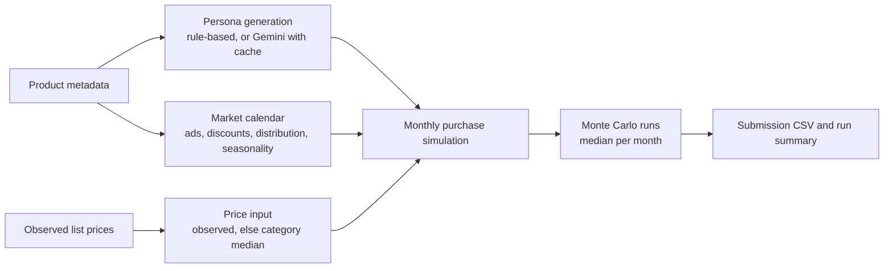

# Cold-Start Demand Simulation for New Products

Persona-based Monte Carlo simulator for 15 new food products without sales
history; awareness, trial, repeat, and price elasticity are editable inputs.
Built for the 2025 Dongwon x KAIST AI Competition (August to September 2025).

**Problem.** Launch volumes, inventory, and promotion timing must be planned
before any sales exist, so a forecasting model has no target. The simulator
turns each assumption (price, promotion, advertising, distribution,
seasonality) into an explicit input and produces 12-month demand scenarios.

**Result.** With seed 42, 400 rule-based personas, and observed list prices, a
900 g premium tuna-extract seasoning sauce totals 3,070,766 simulated units over
12 months (per-month median of 7 Monte Carlo runs); across the 15 products,
12-month totals range from 1,941,646 to 7,918,193. Rerunning with the same
seed reproduces the file exactly. These are scenarios, not forecast accuracy.

**Scope.** A simulation with no observed sales or backtest. Data is included;
`python forecast_pipeline.py make_submission --product_csv data\product_info.csv --use_llm 0`
runs the rule-based scenario without API keys.

[한국어](README.ko.md) · [Case study](PORTFOLIO.md) · [Architecture](docs/ARCHITECTURE.md)

## Data and assumptions

- [`data/product_info.csv`](data/product_info.csv): 15 products with name,
  feature text (ingredients, advertising months, ad model), and a three-level
  category.
- [`data/category_prices.csv`](data/category_prices.csv): 15 list prices
  collected from Naver Shopping on 2025-08-26, one listing per product.
- Hand-set defaults in `forecast_pipeline.py`: base awareness 0.18, trial rate
  0.35, repeat rate 0.55, price elasticity -1.2, ad effect 0.10 per 100 GRP
  (gross rating points), promotion pass-through 0.8. Market size is a
  per-category heuristic.

## Scenario design



Each persona gets a purchase utility from its attributes, price, discounts,
advertising, distribution, and seasonality. Monthly trial units are market size
x mean purchase probability; repeat units grow with cumulative trials. Each
product runs several Monte Carlo times and the submission keeps the per-month
median. Details: [docs/ARCHITECTURE.md](docs/ARCHITECTURE.md).

**Reproducibility.** Every random draw comes from a NumPy generator seeded by
`--seed` (default 42) plus a CRC32 hash of the product name, so output does not
depend on `PYTHONHASHSEED`. Two runs with seed 42, one under
`PYTHONHASHSEED=123`, wrote identical submissions; seed 7 wrote a different one.

**Personas.** The rule-based path generates exactly `--persona_count`
personas per Monte Carlo run. When an LLM or its cache returns fewer, the
pipeline logs a warning with the actual count and records it in
`results/run_summary.csv`.

**Price input.** Each product uses, in order: a `price` or `list_price`
column in `product_info.csv` if present, its observed list price, a saved
LightGBM model, the median observed price of its category, then a hand-set
unit-price table. `train_price_model` saves the model only if it beats the
category median on leave-one-out over the 15 observed prices. It does not:

| Leave-one-out, 15 prices | MAE (KRW) | MAPE |
|---|---:|---:|
| Category median (baseline) | 4,920 | 101.3% |
| LightGBM, competition settings | 7,722 | 147.3% |
| LightGBM, small-data settings | 9,474 | 196.1% |

So no model is saved and all 15 products run on their observed price. The
competition-time model, trained on 12 rows, found no split (train R² 0.0000,
test R² -0.1779) and returned KRW 14,093 for every product.

## Results

`results/submission.csv`, seed 42, 400 rule-based personas, 7 Monte Carlo runs:

| Premium seasoning sauce 900 g | Value |
|---|---:|
| Month 1 simulated units | 54,580 |
| Month 12 simulated units | 471,831 |
| 12-month total | 3,070,766 |
| Price input (observed) | KRW 22,400 |

Growth comes from the assumed distribution ramp (35% to 100% coverage) and
repeat purchases that scale with cumulative trial units. Trial units are not
removed from the untried pool, so cumulative trial units are purchase volume,
not unique buyers. Per-product prices, market sizes, persona counts, and seeds
are in `results/run_summary.csv`.

The competition run (Gemini, 3 personas, constant KRW 14,093 price) gave
7,207,421 units for the same product in one Monte Carlo run; its files are kept
in `results/competition_2025/`.

## How to run

```powershell
pip install -r requirements.txt
python forecast_pipeline.py make_submission --product_csv data\product_info.csv --use_llm 0
python forecast_pipeline.py make_submission --product_csv data\product_info.csv --use_llm 0 --seed 7 --persona_count 400 --mc_runs 7
python forecast_pipeline.py train_price_model    # leave-one-out price comparison
```

The first command takes about 40 seconds. `--use_llm 0` uses rule-based
personas and needs no API key. Gemini personas (`--use_llm 1`) need
`GOOGLE_API_KEY` and the `google-generativeai` package; `gather_prices` needs
Naver API credentials. Outputs go to `results/` and `persona_cache/`.

## Limitations

- Simulation, not forecast: no observed sales, backtest, or competition score.
- Observed prices are one listing each and do not track pack size (90 g at KRW 19,050, 135 g at KRW 16,275), so the price effect inherits that noise.
- Rule-based personas are random draws, not fitted to survey or panel data.
- No sensitivity sweep, so which assumption moves the total most is unmeasured.

## Repository layout

```text
forecast_pipeline.py     maintained CLI: gather_prices, train_price_model, make_submission
project_config.py        result, cache, model, and calibration paths
simulation_pipeline.py   separate simplified example, not the maintained engine
data/                    product list and 15 observed prices
notebooks/               experiment and final-run notebooks with saved outputs
results/                 seed-42 run: submission, run summary, report, monthly components, prompt
results/competition_2025/ competition-run report, monthly forecast, prompt, sources, submission
```

## Documentation

- [Portfolio case study](PORTFOLIO.md)
- [Architecture](docs/ARCHITECTURE.md)
