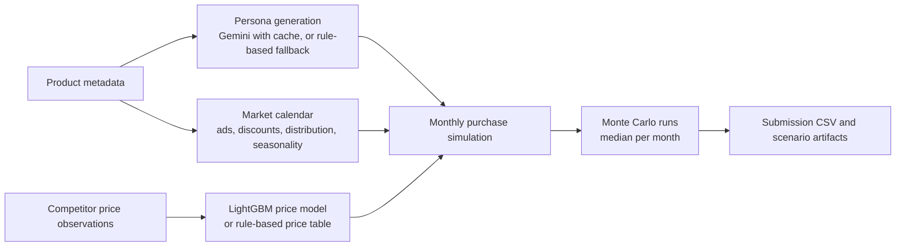

# Cold-Start Demand Simulation for New Products

Persona-based Monte Carlo simulator for 15 new food products without sales
history; awareness, trial, repeat, and price elasticity are editable inputs.
Built for the 2025 Dongwon x KAIST AI Competition (August to September 2025).

**Problem.** Launch volumes, inventory, and promotion timing must be planned
before any sales exist, so a forecasting model has no target. The simulator
turns each assumption (price, promotion, advertising, distribution,
seasonality) into an explicit input and produces 12-month demand scenarios.

**Result.** In a single run with 3 personas, a 900 g premium tuna-extract
seasoning sauce totals 7,207,421 simulated units over 12 months. This is a
scenario, not a forecast-accuracy result.

**Scope.** A simulation with no observed sales or backtest; the 3 personas were
reused across all Monte Carlo runs, and price is the same for every product.
Data is included;
`python forecast_pipeline.py make_submission --product_csv data\product_info.csv --use_llm 0`
runs a rule-based scenario without API keys.

[한국어](README.ko.md) · [Case study](PORTFOLIO.md) · [Architecture](docs/ARCHITECTURE.md)

## Data and assumptions

- [`data/product_info.csv`](data/product_info.csv): 15 products with name,
  feature text (ingredients, advertising months, ad model), and a three-level
  category.
- [`data/category_prices.csv`](data/category_prices.csv): 15 list prices
  collected from Naver Shopping on 2025-08-26.
- Hand-set defaults in `forecast_pipeline.py`: base awareness 0.18, trial rate
  0.35, repeat rate 0.55, price elasticity -1.2, ad effect 0.10 per 100 GRP
  (gross rating points), promotion pass-through 0.8. Market size is a
  per-category heuristic.

## Scenario design



Each persona gets a purchase utility from its attributes, price, discounts,
advertising, distribution, and seasonality. Monthly trial units are market size
x mean purchase probability; repeat units grow with cumulative trials. Each
product runs several Monte Carlo times and the submission keeps the per-month
median. Details: [docs/ARCHITECTURE.md](docs/ARCHITECTURE.md).

## Results

| Single run, 3 personas (premium seasoning sauce 900 g) | Value |
|---|---:|
| Month 1 simulated units | 123,287 |
| Month 12 simulated units | 1,321,951 |
| 12-month total | 7,207,421 |
| Price input | KRW 14,093 |

Growth comes from the assumed distribution ramp (35% to 100% coverage) and
repeat purchases that scale with cumulative trial units. Trial units are not
removed from the untried pool, so cumulative trial units are purchase volume,
not unique buyers.

## How to run

```powershell
pip install -r requirements.txt
python forecast_pipeline.py make_submission `
  --product_csv data\product_info.csv `
  --out_csv results\submission.csv `
  --use_llm 0 --persona_count 400 --mc_runs 7
```

`--use_llm 0` uses rule-based personas and needs no API key. Gemini personas
(`--use_llm 1`) need `GOOGLE_API_KEY` and the `google-generativeai` package;
`gather_prices` needs Naver API credentials. Without `results/price_model.pkl`
the rule-based price table is used, so a fresh run will differ from the
scenario above. Reruns are not bit-identical unless `PYTHONHASHSEED` is fixed.
Outputs go to `results/` and `persona_cache/`.

## Limitations

- Simulation, not forecast: no observed sales, backtest, or competition score.
- Only 3 personas: `persona_count` was 400, but Gemini returned 3 personas for this product, and those 3 were reused across all seven Monte Carlo runs.
- Price does not differentiate products: the LightGBM price model, trained on 12 of the 15 observed prices, found no split (train R² 0.0000, test R² -0.1779) and returns KRW 14,093 for every product.
- No sensitivity sweep, so which assumption moves the total most is unmeasured.

## Repository layout

```text
forecast_pipeline.py     maintained CLI: gather_prices, train_price_model, make_submission
project_config.py        result, cache, model, and calibration paths
simulation_pipeline.py   separate simplified example, not the maintained engine
data/                    product list and 15 observed prices
notebooks/               experiment and final-run notebooks with saved outputs
results/                 scenario report, monthly forecast, prompt, sources, submission file
```

## Documentation

- [Portfolio case study](PORTFOLIO.md)
- [Architecture](docs/ARCHITECTURE.md)
